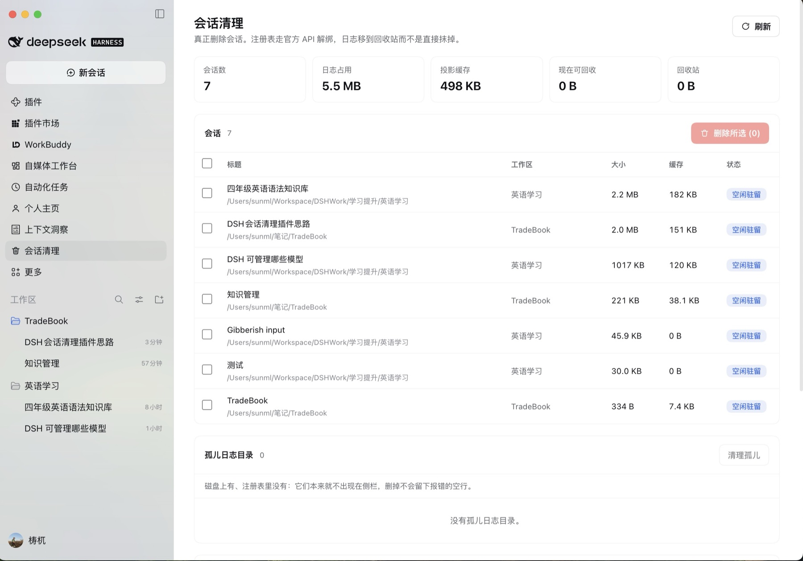

# dsh-session-cleanup

**给 DeepSeek Harness 补上「彻底删除会话」。**

[](LICENSE)
[](package.json)

作者：[FelixSun](https://github.com/FelixRaySun)

DSH 只有归档：归档只是往一个 id 数组里加一项，日志文件一个字节都不动。想真正释放磁盘、抹掉历史，官方目前没给功能。这个插件补上这一层，而且**不需要退出应用、不需要手改 `workspace.json`**。



---

## 为什么不用手改 `workspace.json`

网上流传的手工流程是：`Cmd+Q` 退出 → 编辑 `~/.dsh/storages/workspace.json` → 重启。因为 Host 内存里持有注册表状态，你在侧栏做任何操作都会把磁盘修改覆盖回去，删掉的会话又冒出来。

这个插件走官方 API：`ctx.workspaceRegistry` 的 `unarchiveSession()` 和 `detachSession()` 都是 durable 写入，写完会发 `domain/changed`，侧栏 feed 实时刷新。注册表可以热改，不存在被覆盖的问题。

---

## 一次删除做了什么

| 步骤 | 动作 | 为什么 |
|---|---|---|
| 1 | **预检** | 拒绝还有运行中轮次 / 子代理 / 后台任务 / 定时任务的会话 |
| 2 | **记账** | 在回收站写 `manifest.json`，记下 id、原路径、工作区、大小、标题 |
| 3 | **解绑** | 取消归档，再从所属工作区 `detachSession`。走 API，实时广播 |
| 4 | **搬走** | 同卷 `rename` 到回收站。原子、瞬时、不拷贝 |
| 5 | **清缓存** | 删掉该会话的投影缓存文档。派生数据，删失败只记警告 |
| 6 | **广播** | `api-session/removed`，客户端立刻丢行 |
| 7 | **报告** | 逐条结果与释放字节数 |

**为什么必须同时动注册表和文件**：侧栏的行来自「live 会话 ∪ 持久化 listing」，`workspace.json` 的 `sessionIds` 只决定归到哪个工作区。只解绑不删文件，行会掉进「未分组」还在侧栏；只删文件不解绑，留下点开报 `session/not-found` 的空行。

---

## 「能不能删」的判据

**不看 `live`，只看有没有真的在跑。**

这是实测结论。DSH 从不驱逐打开过的会话——归档也不驱逐——所以 `ctx.sessions.list()` 里长期躺着所有你打开过的会话。在一台有 4 个历史会话的机器上，4 个全部 `live: true`。按「live 即拒绝」处理的话，这个插件几乎删不掉任何东西。

真正的判据是 `ctx.waterfall('workspace/session-activity')`：组合里的提供者会报告这个会话上还有没有运行中的轮次、子代理、后台任务或定时任务。

| 页面标签 | 含义 | 可删 |
|---|---|---|
| 有任务 | 有运行中的轮次 / 子代理 / 后台任务 / 定时任务 | 否 |
| 已归档 | 在归档集合里 | 是 |
| 空闲驻留 | 还在内存里，但没在工作 | 是 |
| 可删除 | 不在内存里 | 是 |

---

## 功能

### 会话列表

- 标题（取自投影缓存，回落到目录名）、cwd、所属工作区
- **日志大小** 与 **投影缓存大小** 分列显示，一眼看出谁占地方
- 状态标签：可删除 / 空闲驻留 / 已归档 / 有任务
- 批量勾选；不可删的会话勾选框直接禁用，不是点了才报错
- 顶部五个指标：会话数、日志占用、投影缓存、现在可回收、回收站

### 孤儿清理

| 类型 | 说明 |
|---|---|
| **孤儿日志目录** | 磁盘上有、注册表里没有。它们本来就不出现在侧栏，删掉不会留下报错的行。同样先进回收站 |
| **孤儿投影缓存** | 没有对应日志的派生数据。缓存过期只会让回放慢一点，不会算错，所以直接删，不备份 |

### 回收站

删掉的日志不会立刻消失，默认保留 **7 天**（`retentionDays` 可配）。

- **还原** — 日志 `rename` 回原位，再 `attachSession` 挂回工作区。工作区目录已不存在时落到「未分组」，不算失败
- **永久删除** — 只在保留期过后才可用，必须显式点名那一批

---

## 安装

### 方式一：从本地目录安装（推荐）

```bash
git clone <this-repo> ~/Workspace/DSHWork/dsh-session-cleanup
```

在 DSH 里打开 **插件 → 添加插件**，填入该目录的绝对路径，选择安装，然后 **立即启用**。

启用后左侧图标栏会出现「会话清理」，点开即用。首次加载若图标未出现，`Cmd+Shift+R` 硬刷新一次。

### 方式二：命令行

```bash
dsh plugin --profile desktop add ~/Workspace/DSHWork/dsh-session-cleanup
```

> **Desktop 用户注意**：`dsh plugin --profile desktop` 要求 profile 已被应用初始化过，并且**必须先完整退出 DSH**（`Cmd+Q`，不是关窗口）再执行，否则会因文件锁失败。装完重新打开应用即可。

### 卸载

插件管理页里关掉开关，或：

```bash
dsh plugin --profile desktop remove dsh-session-cleanup
```

卸载不会动你的会话数据，也不会删回收站里已有的备份。

---

## 配置

在 profile 的 `cordis.patch.yml` 里改：

```yaml
- insert:
    - id: dsh-session-cleanup
      name: dsh-session-cleanup
      config:
        retentionDays: 7   # 回收站保留天数，0 表示随时可永久删除
```

---

## 数据位置

| 内容 | 路径 |
|---|---|
| 会话日志 | `<DSH_HOME>/sessions/<工作区编码>/<会话 id>/` |
| 投影缓存 | `<DSH_HOME>/storages/session_projcache/sessions/<会话 id>.json` |
| 回收站 | `<DSH_HOME>/trash/dsh-session-cleanup/<时间戳>/` |

`<DSH_HOME>` 默认是 `~/.dsh`，可用 `DSH_HOME` 覆盖。

---

## 本地 HTTP 接口

Host 侧在 `/api/dsh-session-cleanup` 下注册五个方法，全部同源校验；POST 只接受 `application/json`。

| 方法 | 路径 | 作用 |
|---|---|---|
| `GET` | `/inventory` | 盘点：会话、孤儿目录、孤儿缓存、回收站、总计 |
| `POST` | `/delete` | `{"ids":[...]}` 删除指定会话 |
| `POST` | `/sweep` | 清理全部孤儿目录与孤儿缓存 |
| `POST` | `/restore` | `{"ids":[...]}` 从回收站还原 |
| `POST` | `/empty-trash` | `{"stamps":[...]}` 永久删除指定批次 |

---

## 安全边界

- **不碰** `~/.dsh/profiles`（插件与凭据）、`settings`、`~/.dsh/attachments`
- **不手写** `workspace.json`；注册表只通过官方 API 修改
- **只 rename 不 rm**；真删只发生在 `empty-trash`，且必须显式点名时间戳、必须已过保留期
- **不自动停会话**：运行中的会话直接拒绝。删除是不可逆的权威操作，需要人确认
- 回收站目录用非递归 `mkdir` 独占分配，同一秒内多次操作追加 `-1`、`-2` 后缀——否则会撞名并覆盖前一批的 `manifest.json`，导致那批永久失去还原能力

---

## 实测记录

在 DSH `0.2.2-rc.5` / macOS 上跑过真实数据，不是推演：

| 验证项 | 结果 |
|---|---|
| 孤儿缓存清理 | 8 个 → 0，投影缓存目录 768 KB → 500 KB |
| 真实删除一个会话 | 日志进回收站，`workspace.json` 里彻底消失（不在任何工作区，也不在归档集合） |
| 还原 | 日志归位、工作区挂回、回收站自动清空 |
| 数据完整性 | 还原前后均为 30,694 字节，完全一致 |
| 保留期保护 | 7 天内 `empty-trash` 返回 `too-young` |
| 界面闭环 | 勾选 → 确认框 → 删除 → 提示条 → 回收站 → 还原 → 侧栏恢复 |
| 误删恢复 | 两批误删全部无损还原（47,036 / 30,694 字节精确一致） |

顺带确认一个安全前提：JSONL 后端的 append 走 `open(path, 'a')` 而不是长期持有 fd，所以日志目录被移走后，目录不存在会报 ENOENT，不会静默重建文件。

---

## 两个实现上的坑

写 DSH 插件时如果也碰到，可以省点时间：

**`api-session/removed` 不等于「日志删掉了」。** 它的语义是「Agent 被释放」，只清 Client 侧缓存，不驱逐 Host 的会话对象。删完之后 `ctx.sessions.list()` 仍会返回那个会话，`sessionPersistence.stat()` 却已经没有它。插件用日志目录是否存在来区分「新建未落盘」和「已删除的内存残留」。

**locale 服务晚于插件就绪。** Client 侧在 `apply()` 里直接 `ctx.get('locale')` 拿到的是 `undefined`，界面文案会安静地回落成英文，不报错。正确做法是先试一次，拿不到就 `ctx.inject(['locale'], ...)` 等它。

---

## 限制

- 附件库 `~/.dsh/attachments` 是内容寻址、没有引用计数的，删会话不会回收它。留待后续版本
- 删掉一个驻留但空闲的会话后，Host 内存里的对象要等进程重启才消失。这期间它不出现在侧栏（日志已不在），也不出现在插件列表（已排除），属于无害残留
- 只支持当前会话格式 v4；更早格式需要 DSH 自己先完成迁移

---

## 兼容性

| 项 | 值 |
|---|---|
| DSH | `>=0.2.2-rc.5 <0.3.0-0` |
| 平台 | macOS / Linux / Windows（Desktop 与 Web 均可） |
| 依赖 | 无。纯 ESM，无构建步骤，无第三方包 |

用到的 Host 服务：`webServer`、`sessions`、`workspaceRegistry`、`sessionPersistence`。Client 侧只用 `slots` 与 `locale`。

---

## 许可证

[Apache License 2.0](LICENSE)

```
Copyright 2026 sunml

Licensed under the Apache License, Version 2.0 (the "License");
you may not use this file except in compliance with the License.
You may obtain a copy of the License at

    http://www.apache.org/licenses/LICENSE-2.0

Unless required by applicable law or agreed to in writing, software
distributed under the License is distributed on an "AS IS" BASIS,
WITHOUT WARRANTIES OR CONDITIONS OF ANY KIND, either express or implied.
See the License for the specific language governing permissions and
limitations under the License.
```

---

## 作者

**FelixSun**

如果这个插件帮你省了事，欢迎提 Issue 或 PR。
